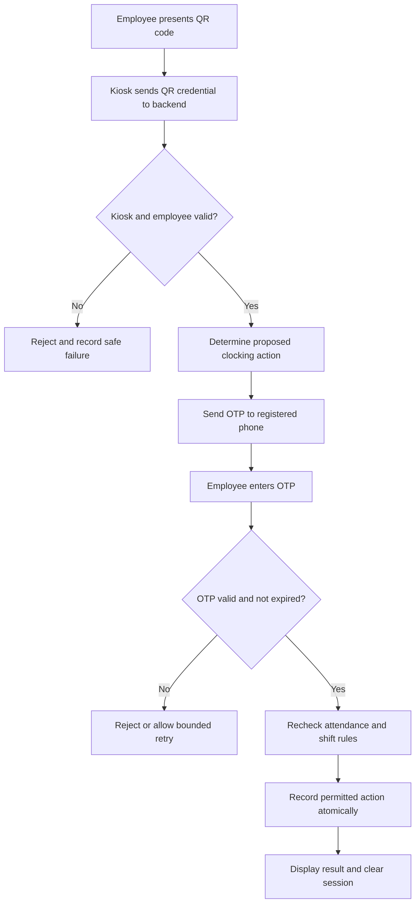

# ATTENDPRO — FINAL PRODUCT REQUIREMENTS DOCUMENT (PRD)

> Version 1.0 · 13 October 2026 · Requirements and planning baseline for DevOS
>
> Provenance: supplied by the Owner, pasted into the DevOS session on 2026-10-14.
> The kiosk workflow in §10.1 arrived as a corrupted export (inline CSS plus a
> Mermaid fragment); it has been reconstructed here as an equivalent Mermaid
> diagram. No requirement text was changed.

## 1. Product overview

Product name: AttendPro

Product type: Multi-business staff attendance management SaaS.

AttendPro is a staff attendance management system that enables businesses to track
employee attendance, monitor punctuality, manage shifts, review attendance records and
configure their attendance policies.

The product consists of three distinct interface areas:

1. Public website: A dashboard-style product preview accessible without logging in.
2. Web application: Authenticated dashboards for STAFF, HR and SUPERADMIN.
3. Attendance kiosk: A dedicated workplace interface for employees to clock in and
   clock out using QR identification and SMS verification.

Although these interfaces serve different purposes, they use a shared backend and
database as the source of truth.

Core principle: The kiosk records attendance. The web dashboards allow authorized users
to review attendance, manage employees and configure the business.

Fingerprint authentication and facial biometrics are excluded from the initial release.

## 2. Problem statement

Many businesses need a reliable way to answer questions such as:

- Who reported to work today?
- Who arrived early, on time or late?
- Who has clocked in but not clocked out?
- Which employees were absent or have incomplete attendance records?
- Which shift is each employee assigned to?
- How can HR correct an attendance error without losing the original record?
- How can a business change its working hours and attendance policies without hiring a
  developer to modify the application?

AttendPro addresses these problems by providing a controlled clocking process,
configurable attendance rules, centralized records and role-specific dashboards.

## 3. Product goals

The system must:

- Provide a simple public preview of the product.
- Separate attendance clocking from the staff reference dashboard.
- Verify employee identity before recording attendance.
- Support multiple businesses with strict data isolation.
- Give each business control over its staff, shifts and attendance policies.
- Calculate attendance status using configured business rules.
- Preserve historical records when business settings change.
- Provide auditable attendance corrections and administrative actions.
- Connect every UI feature to a real backend operation and database model.
- Be designed and reviewed through DevOS before implementation begins.

## 4. User roles and permissions

AttendPro has three confirmed business-level roles.

| Role | Purpose |
|------|---------|
| STAFF | Views personal attendance and relevant employment information. |
| HR | Monitors attendance and manages authorized employee and attendance workflows. |
| SUPERADMIN | Manages the configuration and users of their own business. |

### 4.1 STAFF

Staff members can:

- View their attendance dashboard.
- Review their own clock-in and clock-out history.
- See their recorded attendance status.
- View assigned shifts and scheduled off-days.
- Change their password.
- Update permitted profile information.
- Submit general help requests.
- Submit attendance correction requests.
- Track the status of submitted requests.

Staff members cannot use their personal dashboard to perform routine clock-in or
clock-out actions. Those actions must go through the authorized workplace kiosk.

Staff must not be able to view other employees' private attendance records.

### 4.2 HR

HR officers can:

- View attendance summaries for their business.
- View employee attendance records.
- Search and filter by employee, date, shift and attendance status.
- Identify early arrivals, on-time arrivals, late arrivals and incomplete records.
- Review attendance exceptions.
- Manage employee accounts within their granted permissions.
- Review help requests.
- Review and decide attendance correction requests.
- Generate authorized attendance reports.
- Review relevant audit history.

HR must not access another business's records.

HR must not approve their own attendance correction requests.

### 4.3 SUPERADMIN

The business SUPERADMIN is the proprietor or authorized administrator of an individual
business.

They can:

- Configure the business profile and supported branding settings.
- Manage business users and roles.
- Create, edit, activate and deactivate shifts.
- Assign employees to shifts.
- Configure working hours and attendance rules.
- Configure off-days and supported scheduling settings.
- Enable or disable automatic clock-out.
- Register and revoke kiosk devices.
- Review attendance reports and audit history.
- Manage supported business-level settings through the UI.

Important: SUPERADMIN is not a platform-wide administrator. Each SUPERADMIN is
restricted to their own business.

A separate AttendPro platform-operations administrator is not included in the confirmed
three-role model. If one is required for SaaS operations, DevOS must propose it
separately for approval.

## 5. Multi-business architecture

AttendPro must support multiple independent businesses on the same platform.

For example:

- Finest Supermarket uses AttendPro.
- A second supermarket uses AttendPro.
- A manufacturing company also uses AttendPro.

Each business has its own employees, shifts, attendance records, settings and kiosk
registrations.

Mandatory rules

1. Each user account belongs to exactly one business.
2. Users cannot switch between multiple business memberships.
3. Each business SUPERADMIN can manage only their own business.
4. HR can view only records within their authorized business.
5. Staff can view only their own personal records.
6. Every relevant database record and backend operation must enforce business ownership.
7. Hiding a page or menu item is not sufficient security; the backend must independently
   authorize every protected request.
8. Tests must prove that one business cannot access or modify another business's data.

## 6. Public website

Purpose

When a visitor opens AttendPro for the first time, they should immediately understand
what the product does.

The public website should present a clean, professional, dashboard-style preview without
requiring login.

Public landing page requirements

The page should include:

- AttendPro branding.
- A concise explanation of the product.
- A small dashboard preview.
- A few sample attendance summary figures.
- A compact example attendance table.
- A Login option.
- A business registration option if that onboarding flow is approved.

The dashboard preview must be simple. It should not display every statistic, every
employee or every feature at once.

Example of illustrative public content:

| Employee | Clock-in | Status |
|----------|----------|--------|
| Sample Employee A | 5:55 AM | Early |
| Sample Employee B | 6:00 AM | On time |
| Sample Employee C | 6:18 AM | Late |

These are fictional examples, not actual attendance records.

Privacy rule: The public website must never expose private employee information or live
business attendance data without authentication and authorization.

## 7. Staff dashboard

After logging in, a STAFF user is directed to their own dashboard.

Suggested dashboard content

- Today's attendance status.
- Assigned shift.
- Last recorded clock-in and clock-out.
- Recent attendance history.
- Upcoming scheduled workdays or off-days, where supported.
- Pending help or correction requests.

Staff navigation

- Overview
- My Attendance
- My Schedule
- Off-days
- Help Requests
- Attendance Corrections
- Profile and Security

These are proposed navigation items for DevOS to design and validate.

There must be no functional routine clock-in or clock-out button in this portal.

## 8. HR dashboard

The HR dashboard focuses on monitoring the business's attendance.

Dashboard overview

It may display compact summaries such as:

- Employees expected today.
- Employees who have clocked in.
- Employees who are late.
- Employees with incomplete attendance.
- Attendance exceptions requiring review.

The exact statistics and layout should be refined during the DevOS design phase.

Attendance table

| Field | Purpose |
|-------|---------|
| Employee | Identify the employee. |
| Employee code | Distinguish employees. |
| Shift | Show the assigned shift. |
| Clock-in | Display recorded arrival time. |
| Clock-out | Display recorded departure time or indicate it is pending. |
| Status | Show the calculated attendance result. |
| Exception | Identify missing punches or other issues. |
| Actions | Open permitted details or initiate an authorized workflow. |

The table should support search, filtering and pagination.

HR should not silently edit attendance directly in the table. Attendance corrections
must follow the approved correction workflow and retain an audit trail.

## 9. Business SUPERADMIN dashboard and settings

The business SUPERADMIN should have a dedicated management area.

Main navigation

- Overview
- Attendance
- Employees
- Shift Management
- Scheduling
- Attendance Policies
- Kiosk Management
- Help and Corrections
- Reports
- Audit Log
- Business Settings

DevOS should propose the final navigation and layout after inspecting the existing
application and design system.

Business settings

The proprietor should be able to manage supported settings without a developer editing
application source code.

Examples include:

- Business name and permitted branding.
- Business timezone.
- Employee account management.
- Shift definitions.
- Employee shift assignments.
- Working hours.
- Grace-period rules.
- Off-days and work calendars.
- Automatic clock-out settings.
- Kiosk device registration and activation.

All settings must be validated by the backend and persisted in the database.

A change to a business setting must not silently rewrite the meaning of historical
attendance records.

## 10. Dedicated attendance kiosk

Purpose

The kiosk is a separate attendance interface used at the workplace.

It can run on a suitable workplace device, such as a tablet or computer. The exact
deployment form—browser-based kiosk page or dedicated kiosk application—remains an
architecture decision for DevOS to evaluate.

The kiosk must be designed for repeated use by multiple employees.

### 10.1 Clock-in and clock-out workflow

### 10.2 Step-by-step process

Step 1: Employee identification

Each employee has an assigned QR code.

The employee presents the QR code to the authorized kiosk. The QR code identifies the
employee or their assigned credential.

Step 2: Backend validation

The backend validates the QR credential and checks:

- Whether the kiosk is authorized.
- Whether the QR credential is valid and has not been revoked.
- Whether the employee belongs to the relevant business.
- Whether the employee account is active.
- Whether the employee can attempt the attendance action.

Step 3: SMS verification

AttendPro sends a one-time passcode (OTP) to the employee's registered personal phone
number.

The kiosk must not let the employee substitute an arbitrary phone number.

Step 4: OTP entry

The employee enters the OTP on the kiosk.

The backend validates the code, expiry, attempt limits and single-use status.

Step 5: Attendance evaluation

After successful verification, the backend determines the valid action based on the
current attendance state and applicable shift rules.

If the employee has no valid open attendance session, the permitted action may be
clock-in.

If the employee has a valid open session, the permitted action may be clock-out.

The backend must not blindly trust an action supplied by the frontend.

Step 6: Persist the result

The backend records the action using a database transaction and appropriate concurrency
protection.

Step 7: Display confirmation

The kiosk displays a clear success or failure message, avoids revealing unnecessary
personal information and returns to its ready state.

### 10.3 Security requirements

- QR identification alone must never authorize a punch.
- Kiosk devices must have their own authentication.
- QR credentials must be designed to reduce copying, guessing and unauthorized reuse.
- OTPs must expire, be single-use and have bounded attempts and resend limits.
- Failed verification must not create a successful attendance record.
- Duplicate requests must not create duplicate punches.
- Kiosk sessions must expire and be cleared between employees.
- Device revocation must prevent further attendance operations from that kiosk.

The QR format, kiosk authentication method, OTP expiry and retry limits require an
architecture proposal before implementation.

## 11. Shifts and scheduling

Different businesses have different working hours. AttendPro must not impose one
universal shift schedule.

Example shifts

These are illustrations only:

| Shift | Example time |
|-------|-------------|
| Morning | 6:00 AM–2:00 PM |
| Afternoon | 2:00 PM–10:00 PM |
| Night | 10:00 PM–6:00 AM |

A business administrator must be able to create its own shifts.

Shift Management requirements

Authorized administrators can:

- Create a shift.
- Name the shift.
- Define its start and end times.
- Configure overnight behavior.
- Activate or deactivate the shift.
- Assign employees to the shift.
- Edit applicable policy settings.
- Choose when a new configuration takes effect.

The system must handle overnight shifts correctly. A shift that starts on one calendar
day and ends on the next must not be treated as an ordinary same-day shift.

Deactivating a shift must not delete its historical attendance records.

## 12. Attendance status and punctuality

Attendance status must be calculated by the backend using the applicable business rules.

Possible statuses include:

- Early
- On time
- Late
- Open session
- Clock-out missing
- Automatically closed
- Absent, where an approved schedule and attendance evaluation support that determination
- Requires review

The final status vocabulary should be standardized during architecture and data-model
design.

Grace periods

Businesses may configure grace-period rules.

AttendPro must not hardcode a universal 15-minute grace period.

For example, one business may permit a five-minute grace period, while another may
choose a different value. The effective rule must be applied according to the employee's
assigned shift and the relevant policy version.

Historical consistency

Suppose a business changes a shift's start time from 6:00 AM to 7:00 AM.

The change should affect the intended future period. It must not automatically
reinterpret every historical attendance record as though the new shift had always
applied.

The system should preserve the relevant shift and policy information used when
attendance was evaluated.

## 13. Automatic clock-out

Some employees may forget to clock out.

AttendPro must support a business-level setting that allows automatic clock-out to be
enabled or disabled.

When enabled

A backend process evaluates eligible open sessions according to the business's
configured rules.

The implementation must:

- Respect the assigned shift.
- Handle overnight shifts.
- Use the configured business timezone.
- Avoid overwriting a real, verified clock-out.
- Avoid closing the same session multiple times.
- Record that the closure was automatic.
- Preserve the original clock-in time and relevant audit information.
- Flag ambiguous cases for HR review rather than guessing.

The exact trigger time, effective clock-out time and status representation remain
decisions for DevOS to propose.

There must be no universal 11:59 PM or 23:59 automatic closure rule.

## 14. Help requests and attendance corrections

These must be separate workflows.

Help requests

Staff can report general issues such as:

- Problems using the kiosk.
- Not receiving an OTP.
- Incorrect profile information.
- Difficulty accessing the system.

A help request should have a status and relevant resolution history.

Attendance corrections

Staff can request a correction when an attendance record is inaccurate.

A correction request must include:

- The attendance record involved.
- The reason for the request.
- The proposed correction.
- The requesting user.
- The reviewer, if assigned.
- The decision and timestamps.

The system must preserve the original values and record the approved changes.

A requester cannot approve their own correction.

Correction history must be auditable. Approved changes must not silently erase the
original record.

## 15. Employee account management

Authorized business users must be able to create and manage employee accounts according
to their permissions.

Employee information may include:

- Employee code.
- First and last name.
- Email.
- Registered phone number.
- Role.
- Department and job title, if supported.
- Assigned shift.
- Active status.
- Password and forced-password-change state, where applicable.

The final schema must be reconciled with the existing Prisma models and repository rather
than blindly replacing existing fields.

Deactivation

When an employee leaves the business, an authorized user should deactivate the account.

The employee must no longer be able to log in or clock in, but historical attendance and
audit records must remain available to authorized users according to the retention
policy.

Hard deletion must not accidentally erase attendance history.

## 16. SMS failures and recovery

SMS delivery is an external dependency and may fail.

AttendPro must handle:

- Provider timeouts.
- Delivery failures.
- Expired OTPs.
- Incorrect OTPs.
- Excessive verification attempts.
- Rate limits.
- Network outages.
- Revoked QR credentials.
- Inactive employees.
- Unauthorized kiosks.

Proposed recovery process

1. Show a clear, privacy-conscious failure message.
2. Allow only a bounded number of OTP resend attempts.
3. Record the failure without logging the OTP itself.
4. Direct the employee to an authorized HR-assisted recovery process if SMS remains
   unavailable.
5. Require an approved identity-verification procedure.
6. Record the assisted action and responsible reviewer in the audit trail.

The QR code alone must never become a fallback authorization method.

The precise assisted-recovery procedure and SMS provider must be approved before
implementation.

## 17. Conceptual database requirements

The following is a conceptual entity inventory, not a finalized Prisma schema.

| Model | Purpose |
|-------|---------|
| Business / Tenant | Stores each business's identity, timezone and permitted configuration. |
| User | Stores employee identity, role, business membership, account status and relevant profile fields. |
| Shift | Stores business-defined shift names, times, overnight behavior and active status. |
| Attendance | Stores clock-in/out records, status, shift association and relevant policy snapshots. |
| KioskTerminal | Stores registered kiosk identity, business association, credential metadata and activation/revocation state. |
| VerificationSession | Tracks short-lived QR-to-OTP verification sessions and their state. |
| AttendanceAttempt | Records successful and failed clocking attempts with safe audit metadata. |
| AttendanceHelpRequest | Stores general help requests and resolution state. |
| AttendanceCorrection | Stores correction proposals, review decisions and before/after values. |
| WorkplacePolicy / PolicyVersion | Stores configurable attendance rules and effective dates. |
| AuditLog | Records sensitive configuration, account, kiosk and attendance-management changes. |

Database integrity requirements

- Enforce tenant boundaries in backend queries and authorization.
- Prevent multiple open attendance sessions for the same employee.
- Use appropriate database constraints and transactions.
- Add indexes for common business, employee, shift and date-range queries.
- Use idempotency protection for retryable clocking operations.
- Preserve historical shift and policy context.
- Avoid cascading deletes that erase historical attendance.
- Store credentials and secrets securely.
- Keep audit history for sensitive operations.
- Define a consistent timestamp and timezone strategy.

DevOS must compare this model inventory with the existing schema and propose exact
fields, relations, enums, indexes and migrations before implementation.

## 18. Backend API responsibilities

The following are API responsibility areas, not final route definitions.

| API area | Responsibilities |
|----------|------------------|
| Authentication | Login, session handling, password changes and authorized profile access. |
| Public website | Public product preview and approved onboarding operations. |
| Staff | Personal attendance history, schedule, help requests and correction requests. |
| HR | Business-scoped attendance queries, employee management and authorized reviews. |
| Business settings | Business profile, shifts, assignments, policies and kiosk administration. |
| Kiosk identification | Kiosk validation, QR validation and verification-session creation. |
| OTP | OTP request, resend, verification, expiry and attempt limits. |
| Attendance | Atomic clock-in/out transitions and audit records. |
| Background jobs | Configurable, shift-aware automatic closure. |
| Reporting | Authorized attendance reports, filters and exports. |
| Audit | Authorized retrieval of relevant audit and correction history. |

Before implementation, DevOS must produce the API contract and map each screen action to
the relevant endpoint, authorization rule, validation and database operation.

## 19. UI design requirements for DevOS

DevOS must own the detailed UI design phase, but only after understanding the existing
application and design system.

The design phase must define:

1. A complete navigation map.
2. The screen inventory for every role.
3. Layout and component decisions.
4. Responsive behavior.
5. Loading, empty, success, error and unauthorized states.
6. Form validation and confirmation flows.
7. Table filters, pagination and detail views.
8. Kiosk screen states and privacy behavior.
9. The relationship between each UI feature and its API.
10. The relationship between each API and its database models.
11. A traceability matrix linking requirements to tests and acceptance criteria.

Screen-to-backend rule

A UI feature is not complete merely because it looks correct.

For every feature, DevOS must answer:

- What does the user do?
- Which role may perform the action?
- Which screen handles it?
- Which API receives the request?
- Which backend service validates it?
- Which database records are read or changed?
- What happens when the request fails?
- How is the feature tested?

No production-looking control should be implemented with fake or disconnected behavior
while being presented as complete functionality.

## 20. Security and privacy

The initial release must include:

- Secure password hashing.
- Authentication and role-based authorization.
- Strict tenant isolation.
- Secure kiosk authentication.
- QR credential validation and revocation.
- Short-lived, single-use OTP verification.
- OTP rate limits and attempt limits.
- Safe error messages.
- Audit logging for sensitive actions.
- Secure secret and environment-variable handling.
- HTTPS for production communications.
- Protection against duplicate and concurrent attendance operations.
- Safe database migrations and backups.
- A defined data-retention policy.
- Appropriate privacy review for employee data and SMS processing.

Because a six-digit OTP has low entropy, DevOS must evaluate appropriate protection for
OTP storage and verification; plain SHA-256 alone should not automatically be assumed
sufficient.

Ghanaian data-protection requirements must be reviewed before production deployment. The
PRD does not substitute for legal advice or a compliance assessment.

## 21. Non-functional requirements

| Area | Requirement |
|------|-------------|
| Correctness | Attendance calculations and state transitions are authoritative on the backend. |
| Security | Enforce least privilege, tenant isolation and secure verification. |
| Reliability | Handle SMS, network, database and background-job failures without falsely reporting success. |
| Usability | Provide simple kiosk interactions and concise role-specific dashboards. |
| Accessibility | Support readable text, clear errors, keyboard navigation where relevant and accessible alternatives. |
| Performance | Use suitable indexes, pagination and efficient tenant-scoped queries. |
| Maintainability | Use typed contracts, validated inputs, modular backend services and documented migrations. |
| Observability | Log relevant failures, verification outcomes, job execution and database errors without exposing secrets. |
| Compatibility | Preserve the existing React/Vite, TypeScript, Express, Prisma and PostgreSQL stack unless architecture review justifies a change. |

## 22. Mandatory forensic reports and repository investigation

DevOS must read both forensic reports before proposing implementation.

The reports are historical snapshots. Their findings must be re-verified against the
current repository.

Phase 1 forensic report

Pasted text(7).txt

This report covered repository structure, the current stack, attendance behavior, tests,
TypeScript issues, Git state and repository anomalies.

Findings that require re-verification include:

- Reported frontend TypeScript errors despite successful tests and lint.
- Attendance status previously hardcoded as PRESENT.
- Potential concurrency issues around multiple open attendance sessions.
- Missing or incomplete kiosk, QR, SMS and automatic closure features at the time of the
  audit.
- A nested backend/.git directory and potentially valuable local changes.
- Historical root Git state and unpushed commits.
- Potentially unsafe backend test database configuration.

These must not be treated as confirmed current defects until checked.

Phase 2 forensic report

Pasted text(10).txt

This report covered the proposed attendance architecture, kiosk verification, OTP
security, data models, concurrency and implementation milestones.

DevOS must reconcile its proposals with this PRD.

In particular:

- Biometrics are excluded from this release.
- QR plus SMS OTP is the chosen kiosk verification flow.
- No universal 15-minute grace period is approved.
- No universal 23:59 automatic clock-out rule is approved.
- Kiosk authentication, QR format, OTP limits and SMS provider still require review.

Repository safety requirements

Before modifying code or data, DevOS must:

1. Inspect the current Git status, branches and working tree.
2. Inspect repository instructions and existing DevOS agents, skills and hooks.
3. Recheck the Prisma schema and migration history.
4. Determine whether backend tests can modify or delete database records.
5. Establish an isolated test database before running potentially destructive
   integration tests.
6. Inspect the nested Git anomaly before any cleanup.
7. Check for secret-leak risks without printing secrets into reports or logs.
8. Preserve valuable existing work unless its removal is explicitly approved.
