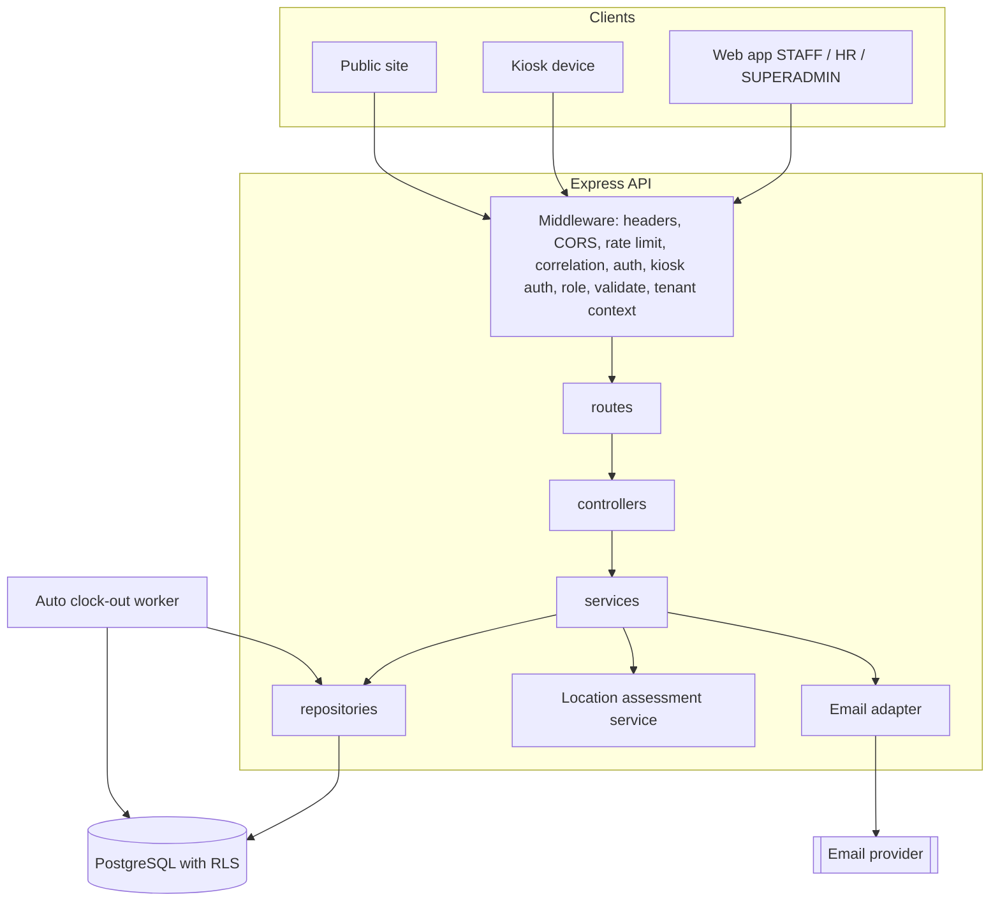

# AttendPro M1 — System Architecture

- **Date:** 2026-10-16
- **Baseline commit:** `f87ce1d`
- **Milestone:** M1
- **Owners:** Architect Agent and DBA Agent
- **Companion documents:** `docs/attendpro/M1-DATA-MODEL.md`, `docs/attendpro/M1-API-CONTRACTS.md`, `docs/attendpro/M1-KIOSK-SECURITY.md`
- **Status:** design only. No production code, no schema change, no migration.

**Revision 2026-10-16.** The owner's M1 design review on this date changed the
verification path. SMS one-time codes are out and the QR badge plus a PIN is in, leave
moves to version two, and the system gains kiosk pairing, GPS geo-fencing, an automatic
clock-out job, a timing policy with effective dates, and a corrections workflow. The
earlier draft of this document was OTP-based. Every control below is written to the
owner-confirmed decisions O2 to O8, O10, O12 and O14 to O17 in
`docs/attendpro/DECISION-REGISTER.md`. The parts worth keeping — the four-layer
dependency, tenancy through `app.business_id` and Row Level Security, the two database
roles, append-only enforcement, the hardened `SECURITY DEFINER` function, connection-pool
mode pinning, and migration safety and recovery — are carried forward unchanged in shape.

The design covers the PRD areas the M0 reality check listed as missing: tenancy (§2), the
status and policy engine (§5 and §6), automatic clock-out (§4), help and correction
workflows (§10), the kiosk subsystem (§7 to §9), and the API and data model of §17 and
§18.

A value marked **Provisional** is a proposal for the owner to accept or change. Every
confirmed decision is designed to as settled, not as a default.

---

## 0. Decisions carried in

The owner confirmed these rows on 2026-10-16. They replace the earlier "provisional
assumptions" table.

| Ref | Confirmed direction | Register state |
|-----|---------------------|----------------|
| O1 | Businesses are provisioned by an operator, not through public self-serve sign-up | Open |
| O2 | Kiosk verification is the employee QR badge plus a PIN. SMS codes are not used for clock-in. The PIN is stored hashed, with attempt limits, rate limits, temporary lockouts, and an audited HR reset | Confirmed (owner, 2026-10-16) |
| O3 | An administrator generates a one-time pairing code that expires in ten minutes; entering it pairs the device and issues a kiosk token. Token lifetime is 30 days, renewed on use, capped at 90 days, and revocable from the devices page | Confirmed (owner, 2026-10-16) |
| O4 | QR identifies the badge; every attempt records its timestamp and a location assessment. Each site carries a geo-fence (centre plus radius; 150 m is an example). Outside is flagged, not blocked. Poor accuracy is `UNKNOWN`, never `OUTSIDE` | Confirmed (owner, 2026-10-16) |
| O5 | The server generates a long random QR credential and stores only a hash, shown once. Reissue revokes the previous credential. A QR alone never authorizes a punch | Confirmed (owner, 2026-10-16) |
| O6 | Email recovery code: six digits, ten-minute expiry, single use, lock after five incorrect attempts, resends no more often than once every 60 seconds, stored hashed and rate limited. Account recovery only | Confirmed (owner, 2026-10-16) |
| O7 | Recovery order: an audited HR PIN reset; badge reissue with the old credential revoked; then a correction request. A failed attempt is never a successful punch | Confirmed (owner, 2026-10-16) |
| O8 | Auto clock-out runs every 15 minutes. An open session past shift end plus a buffer (default two hours) is closed at shift end and flagged; with no shift it closes after a maximum duration (default 14 hours) | Confirmed (owner, 2026-10-16) |
| O10 | Retention is configurable per business and off by default. Attendance, correction history, audit logs and security events may keep different periods. Legal advice precedes enabling deletion | Confirmed (owner, 2026-10-16) |
| O11 | No platform-operations role in this release; kiosk administration stays with the business `SUPERADMIN` | Open |
| O12 | A `tokenVersion` guards sessions. Every request verifies the user is active, the version is current, the action is authorized, and the request is scoped to the business. Deactivation bumps the version and revokes the QR credential | Confirmed (owner, 2026-10-16) |
| O14 | A separate test database with fake data only. Tests refuse to run unless the database name ends in `_test`, and the configured host is verified before a destructive reset | Confirmed (owner, 2026-10-16) |
| O15 | `SUPERADMIN` controls business-wide timing rules. One late grace applies across shifts unless the owner changes it. Timing changes take effect from the next business midnight and never recalculate history | Confirmed (owner, 2026-10-16) |
| O16 | Version one includes shift assignment, working-day and off-day configuration, absence calculation, and a per-business rule for observing public holidays. Leave requests, allocation and timetable upload are deferred to version two | Confirmed (owner, 2026-10-16) |
| O17 | An employee may correct their own record within seven days with a reason. HR approves same-day fixes; older fixes follow a stricter review. Nobody approves their own record. History is append-only | Confirmed (owner, 2026-10-16) |
| O21 | Append-only protection (grants, RLS and a trigger) is confirmed for the correction history and the audit log | Confirmed (owner, 2026-10-16) |
| O22 | One default working calendar per business in v1, with the schema already allowing more later | Confirmed (owner, 2026-10-16) |

The earlier leave workflow (was O19) is deferred to version two by O16. The `LeaveType` and
`LeaveRequest` models come out of version one, and no leave source affects absence (§4.4).

Migration safety (was O20) stays in the plan: a `pg_dump` backup plus a restore rehearsal
in the test database precedes every forward migration. It still needs owner sign-off.

Two further provisional values introduced here and not in the register:

- Runtime database role: the API connects as a non-owner role subject to Row Level
  Security, while migrations run as the schema owner. **Provisional (new).**
- Tenant setting name: the per-transaction Postgres setting is `app.business_id`.
  **Provisional (new).**

---

## 1. Module boundaries

The backend keeps the existing Express, TypeScript, Prisma and PostgreSQL stack (PRD §21).
Inside that stack the code is split into four layers with a single direction of
dependency: routes call controllers, controllers call services, services call
repositories, and repositories are the only layer that touches Prisma.

| Layer | Responsibility | Must not do |
|-------|----------------|-------------|
| `backend/routes/*` | Compose middleware and bind paths to controllers | Hold logic, touch Prisma |
| `backend/controllers/*` | Read validated input from the request, call one service, shape the HTTP response | Decide business rules, touch Prisma |
| `backend/services/*` | Own business rules, transactions, cross-entity checks, external calls through adapters | Read `req` or write `res` |
| `backend/repositories/*` | Run Prisma queries, always inside a tenant transaction, always scoped by `businessId` | Enforce authorization policy |
| `backend/adapters/*` | Wrap external systems (the email sender for recovery codes) behind an interface | Leak provider types into services |

Cross-cutting pieces keep their current homes and gain responsibilities:

- `backend/middleware/*` holds security headers, CORS, rate limiting, correlation id,
  authentication, kiosk authentication, role authorization, request validation, and the
  tenant-context middleware.
- `backend/validators/*` holds the Zod schemas. Zod remains the single source of input
  validation, matching `validate.ts` today.
- `backend/errors/*` holds the typed error classes described in §11.
- `backend/jobs/*` holds the scheduled workers described in §4.
- `backend/services/locationAssessment.ts` owns the geo-fence evaluation described in §9.
- `backend/utils/*` holds logging, timezone conversion, the distance helper the location
  service uses, and the HMAC helpers the kiosk design names.



The kiosk reaches the same route table as the web app through a distinct authentication
path: `POST /api/kiosk/pair` redeems a one-time pairing code and issues a kiosk token, and
kiosk routes verify that token on every call (§8 and `M1-KIOSK-SECURITY.md` §2). A kiosk
token carries no employee identity, so a stolen kiosk token does not become a stolen staff
session.

**PRD coverage:** §3 (goals), §17 (integrity), §18 (API responsibilities), §21
(maintainability, compatibility).

---

## 2. Tenancy enforcement

PRD §5 rules 6 to 8 require every record and every operation to carry a business owner
and to be authorized on the backend. The design enforces tenancy three times over:
once when the request context is built, once in each repository query, and once in the
database through Row Level Security.

### 2.1 Where `businessId` comes from

`businessId` is never read from the request body, query string, or a client header. It
is resolved from the caller's authenticated identity:

- A staff, HR, or SUPERADMIN request runs `authMiddleware`, which already reloads the
  account row from the database. The reload is extended to select `businessId`, and the
  middleware attaches `req.user.businessId`. A role held in a stale token cannot outlive
  the database, and neither can the business scope.
- A kiosk request runs the kiosk middleware from `M1-KIOSK-SECURITY.md` §2.5. That
  middleware reloads the `KioskTerminal` row, confirms it is `ACTIVE`, that the token is
  current and unexpired, and that the device belongs to the business named on the
  request, then attaches `req.kiosk.businessId`.
- A background job supplies a business id from its own scheduling table, not from an
  HTTP caller.

A handler therefore reads the tenant from `req.user.businessId` or
`req.kiosk.businessId`. A header like `X-Business-Id` is ignored if present. PRD §5 rule
7 says a hidden control is not security, and the backend supplies the scope itself.

### 2.2 Tenant middleware

A small `tenantContext` middleware runs after authentication and attaches
`req.tenant = { businessId }`. It rejects the request with `403` when the identity has no
business. Controllers pass `req.tenant.businessId` into services; services pass it into
repositories. The value exists in exactly one place per request, which keeps a query
from accidentally running unscoped.

### 2.3 Repository scoping

Every repository function takes `businessId` as its first argument and includes it in
the Prisma `where` clause for reads, updates, and deletes:

```
prisma.attendance.findMany({ where: { businessId, ...filters } })
prisma.attendance.updateMany({ where: { id, businessId }, data })
```

For a mutation by primary key, the repository uses `updateMany` or a `findFirst` guard so
a row from another business returns "not found" rather than being written. A `404` for
another business's row is deliberate: it does not confirm that the row exists elsewhere.
This mirrors the current `getUserById` ownership check, extended to the tenant.

Application scoping alone would be enough only if every query remembered it. The
database check in §3 catches the query that forgets.

### 2.4 Kiosk-to-employee binding

The kiosk path adds one more check: the employee resolved from the QR credential must
belong to the same `businessId` as the kiosk (PRD §5 rule 4, and
`M1-KIOSK-SECURITY.md` §2.6). A QR from business B presented at a kiosk of business A
fails before a verification session is created.

**PRD coverage:** §5 (all rules), §4.2 and §4.3 (HR and SUPERADMIN scope), §15
(deactivation), §20 (tenant isolation).

---

## 3. Row Level Security

Row Level Security is the database-level backstop. It sits behind §2 rather than
replacing it. If a repository query forgets `businessId`, RLS still returns no rows, and
the request fails closed rather than leaking another tenant's data.

### 3.1 Roles

Two database roles are used.

| Role | Used by | RLS |
|------|---------|-----|
| `attendpro_owner` | `prisma migrate` and seed fixtures, via `DATABASE_URL` | Bypasses RLS as the table owner |
| `attendpro_app` | the running API and jobs, via `DATABASE_URL_APP` | Subject to RLS, no `BYPASSRLS` |

Keeping the roles separate means a migration can create tables and backfill columns
without a policy blocking it, while the runtime cannot see another tenant's rows even
with a crafted query. **Provisional (new):** the names above.

### 3.2 The tenant setting

Every tenant table carries a `business_id` column, including tables where it could be
derived through a join. Denormalising it keeps the policy a single-column predicate,
because an RLS policy cannot cheaply join to another table.

Policies read a transaction-scoped setting:

```sql
ALTER TABLE attendances ENABLE ROW LEVEL SECURITY;

CREATE POLICY attendances_tenant_isolation ON attendances
  USING (business_id = current_setting('app.business_id', true))
  WITH CHECK (business_id = current_setting('app.business_id', true));
```

`current_setting('app.business_id', true)` returns NULL when the setting is absent, and
a comparison with NULL is never true, so a query that runs without a tenant context
returns no rows and an insert without one is rejected. That is the fail-closed
behaviour the PRD asks for.

`audit_logs` is append-only: it gets a `SELECT` policy and an `INSERT` policy, and no
`UPDATE` or `DELETE` policy, so corrections and configuration changes stay in the log.

The per-table policy list is in `M1-DATA-MODEL.md` §5.

### 3.3 How Prisma sets the setting

Prisma Client connects through the driver adapter already in use (`PrismaPg` in
`backend/config/prismaClient.ts`). Because the setting must be scoped to one request and
one connection checkout, every tenant query runs inside an interactive transaction that
sets the value with `set_config` and `is_local = true`:

```ts
await prisma.$transaction(async (tx) => {
  await tx.$executeRaw`SELECT set_config('app.business_id', ${businessId}, true)`;
  return repositoryFn(tx);
});
```

`set_config(..., true)` is equivalent to `SET LOCAL`: it reverts at transaction end, so a
pooled connection cannot leak one tenant's setting into the next request. The repository
layer exposes a `withTenant(businessId, fn)` helper and never queries tenant tables
outside it. Prepared statements and the connection pool are unaffected.

Two operations run outside a tenant transaction: login and the public preview. Login
resolves an account before a business is known, so it calls a `SECURITY DEFINER`
function (`authenticate_lookup(email)`) owned by `attendpro_owner` that returns only the
authentication fields for one email. The app role can execute that function and nothing
else on `users` without a tenant context. The public preview reads no tenant table. Both
are described in `M1-API-CONTRACTS.md`.

### 3.4 Interaction with development and tests

The current backend suite writes to the development database (M0 finding F7). Under RLS
the app role cannot write without a tenant, which makes the missing test database a
harder failure, not a quiet one. O14's isolated database is the fix, and the test suite
and the migration runner both refuse to run unless the database name ends in `_test`
(§16.4). The DBA agent's seed fixtures must run as `attendpro_owner`.

### 3.5 Write permissions per role

The grant matrix is the first layer of write control; RLS is the second. The matrix:

| Table group | `attendpro_app` | `attendpro_owner` |
|-------------|-----------------|-------------------|
| Tenant tables the API updates (`businesses`, `users`, `shifts`, `attendances`, `shift_assignments`, `workplace_policies`, `policy_versions`, `sites`, `kiosk_terminals`, `qr_credentials`, `verification_sessions`, `attendance_help_requests`, `attendance_corrections`, `work_calendars`, `calendar_exceptions`, `email_recovery_codes`) | `SELECT`, `INSERT`, `UPDATE`, `DELETE`, each scoped by RLS | full DML; bypasses RLS as table owner |
| Append-only tables (`audit_logs`, `attendance_correction_revisions`, `attendance_attempts`) | `SELECT`, `INSERT` only | `SELECT`, `INSERT`, `UPDATE`, `DELETE` for lawful retention |

The runtime tables list matches the nineteen models of `M1-DATA-MODEL.md` §2: sixteen
business-scoped tables the API mutates, plus the three append-only tables. The
`otp_challenges` table and the leave tables no longer exist in v1.

`attendpro_app` holds no `BYPASSRLS` attribute, so a query with no tenant setting returns
no rows and an insert is rejected (§3.2). Migration 9 sets these grants. The
cross-business isolation tests T18, T19 and T20 assert the policy side of the matrix: a
cross-tenant insert is rejected, a cross-tenant update affects zero rows, and a delete
from `audit_logs` is refused.

### 3.6 Append-only enforcement

`audit_logs`, `attendance_correction_revisions` and `attendance_attempts` keep history
that must not be rewritten. Three layers sit between a statement and the row:

1. **Grants.** `attendpro_app` holds `SELECT` and `INSERT` only, never `UPDATE` or
   `DELETE`.
2. **Policies.** Each table has a `SELECT` policy and an `INSERT` policy and no `UPDATE`
   or `DELETE` policy. RLS denies the missing commands even if a grant is widened.
3. **Trigger.** A `BEFORE UPDATE OR DELETE` trigger on each table raises an exception, so
   an owner-role statement that bypasses RLS is refused unless the trigger is disabled
   for a recorded retention purge.

`attendpro_owner` keeps `UPDATE` and `DELETE` for retention work (O10). The three layers
are specified in `M1-DATA-MODEL.md` §10, and the SQL for them lands in migration 9. Test
T20 covers the policy layer: a delete from `audit_logs` is refused.

### 3.7 The hardened login lookup

Login resolves an account before any business is known, so it runs through one
`SECURITY DEFINER` function, `authenticate_lookup(email)`, owned by `attendpro_owner`.
The function returns only the authentication fields for one email. Three settings make it
safe:

- `SET search_path = pg_catalog, public` is pinned on the function, so a caller cannot
  redirect an unqualified name to a table of their own.
- `EXECUTE` is revoked from `PUBLIC` and granted to `attendpro_app` alone, so no other
  role can call it.
- It is the only path by which `attendpro_app` reads `users` without a `business_id`
  setting.

```sql
CREATE FUNCTION authenticate_lookup(p_email text)
  RETURNS TABLE (id text, business_id text, password text, role text, is_active boolean)
  LANGUAGE sql
  SECURITY DEFINER
  SET search_path = pg_catalog, public
AS $$ ... $$;

REVOKE EXECUTE ON FUNCTION authenticate_lookup(text) FROM PUBLIC;
GRANT EXECUTE ON FUNCTION authenticate_lookup(text) TO attendpro_app;
```

The function is created in migration 9. The API contract in `M1-API-CONTRACTS.md` §1
calls it as `SELECT * FROM authenticate_lookup($1)`. Tests S3 and S4 exercise the login
path it serves.

### 3.8 Connection pooling and the tenant setting

The tenant setting is written with `SET LOCAL` / `set_config(..., is_local = true)`,
which reverts at transaction end. That revert only guards the next request when the
physical connection is not shared inside an open transaction, so the pool mode has to be
pinned.

The supported mode is transaction pooling (PgBouncer `pool_mode = transaction`). A client
gets a server connection for one transaction and returns it at commit or rollback, so the
setting is cleared before the connection is reused. Transaction pooling is compatible with
`SET LOCAL`.

Statement pooling (`pool_mode = statement`) is not supported. It can hand a different
server connection to the next statement inside the same transaction, so a `SET LOCAL`
written by one statement may not be visible to the next and the tenant setting can be
lost.

The runtime connection string (`DATABASE_URL_APP`) must name the transaction-pooling
endpoint. Migration and seed connections (`DATABASE_URL`) run as `attendpro_owner` and
bypass the transaction pool so DDL and advisory locks are not interleaved. Test T21 covers
the leak guard: two tenant transactions on the same pool run back to back and the second
sees only its own rows.

**PRD coverage:** §5 (rules 6 to 8), §17 (tenant boundaries), §20 (least privilege).

---

## 4. Automatic clock-out job

PRD §13 requires a shift-aware, timezone-aware automatic clock-out that respects a
business-level switch and never overwrites a real clock-out. O8 confirms the timing: one
pass every 15 minutes. The current process has no scheduler (M0 finding F4).

### 4.1 Runtime choice

The job runs as a separate entrypoint, `backend/jobs/autoClockOut.ts`, invoked by an
external scheduler every 15 minutes (a cron entry, a Windows Task Scheduler task, or a
container `CronJob`). It runs to completion and exits. An in-process `setInterval` was
rejected because it doubles the work whenever a second API instance starts and leaves
no clean way to record a run.

Overlapping runs are prevented by a Postgres advisory lock:

```sql
SELECT pg_try_advisory_lock(<fixed-key>);
```

A second process that cannot take the lock exits without doing work. This is simpler
than a distributed scheduler and needs no extra service.

### 4.2 What a run does

1. Take the advisory lock. If it is held, exit.
2. Read the active businesses with automatic clock-out enabled.
3. For each business, open one interactive transaction, set `app.business_id` (§3.3),
   and select the open sessions that are eligible in the business timezone:
   - a session with a shift snapshot whose scheduled end has passed by more than the
     buffer (`autoClockOutBufferMinutes`, default 120);
   - a session with no shift whose open duration exceeds the maximum
     (`autoClockOutMaxOpenMinutes`, default 840 minutes, i.e. 14 hours) since clock-in.
4. For each eligible session, close it only if it is still `OPEN`:
   - `clock_out = scheduled shift end instant`, computed from the shift snapshot on the
     attendance row, never from the shift's current definition and never from the run
     time (PRD §12).
   - a session with no shift closes at `clock_in + autoClockOutMaxOpenMinutes`.
   - `session_status = CLOSED`, `status = AUTO_CLOSED`,
     `closure_reason = AUTO_CLOCK_OUT`, and a `requires_review_reason` flag so the
     closure is visible for review.
   - `hours_worked` recomputed from the stored clock-in.
5. A session whose shift snapshot is missing or whose overnight window is ambiguous is
   moved to `REQUIRES_REVIEW` instead of being closed with a guessed time (PRD §13, last
   bullet).
6. Write an `AuditLog` row with `actor_type = SYSTEM` and a summary count.
7. Release the lock on exit.

Overnight and cross-midnight shifts belong to the day they start. An overnight shift
that begins at 22:00 on the 1st and ends at 06:00 on the 2nd is evaluated on its actual
interval, so the buffer is measured from the real end instant on the 2nd while the
`business_date` stays the 1st (§5.2).

Because step 4 filters on `session_status = 'OPEN'`, a second run that races the first
matches nothing. A verified clock-out that already closed the session is never touched,
and the job never overwrites a genuine clock-out. The per-user partial unique index on
open sessions (`M1-DATA-MODEL.md` §2) means at most one row per employee is in scope
anyway. Those two properties make the job idempotent.

### 4.3 Manual trigger

The same service backs `POST /api/jobs/auto-clock-out/run` so an operator or a test can
run one pass. The HTTP path requires a service token, not a user session, and returns
the same counts. The scheduled path is the normal one.

### 4.4 Day-close absence

The same scheduled worker writes absence at day close. For each business date that has
ended, in the business timezone, it reads the employees who were scheduled on a working
day per the `WorkCalendar` and not a non-working `CalendarException`, and writes one
`Attendance` row with `status = ABSENT` and `closure_reason = ABSENT_NO_SHOW` for each
employee who did not clock in by shift end plus grace. Leave is deferred to version two
(O16), so no leave source is consulted: an approved-leave exemption is not part of the
rule in v1. The rule and the models are in `M1-DATA-MODEL.md` §8. The pass checks for an
existing `Attendance` row for the employee and date before writing, so a date that
already has a row produces no second one.

**PRD coverage:** §13 (all bullets), §12 (historical shift snapshot), §21
(reliability, observability).

---

## 5. Timezone strategy

PRD §13 and §9 require the business timezone to drive automatic closure and scheduling,
and §17 requires one consistent timestamp strategy. The rule is: store instants in UTC,
present them in the business timezone.

### 5.1 Storage

- Every instant column is `@db.Timestamptz(3)`, which stores an absolute point in time.
  The current columns are `TIMESTAMP(3)` without a timezone; the migration converts them
  with `USING col AT TIME ZONE 'UTC'`, assuming existing values were written as UTC,
  which the current code does (`new Date()`).
- The business timezone is an IANA name (`Africa/Accra` for the Ghana deployment) stored
  on `Business.timezone`. It is data, not a constant.
- A shift's wall-clock window is stored as minute-of-day integers
  (`startMinute`, `endMinute`, both 0 to 1439) plus a `crossesMidnight` flag. Storing
  minutes rather than text removes the current free-text `startTime`/`endTime` columns
  as the source of truth. **Provisional (new):** minute-of-day representation.
- Each attendance row stores the business-local calendar date it belongs to
  (`business_date`, a `date`), derived from the clock instant in the business timezone.
  Range queries and reports filter on this column, so a report for "1 October" means the
  business's 1 October, not UTC's.

### 5.2 Conversion

- An instant is turned into a local time with a timezone-aware library (`date-fns-tz` or
  `Luxon`), using the business timezone. No fixed offset arithmetic.
- A shift window is turned into an instant by combining the business date with
  `startMinute`, then adding a day when `crossesMidnight` is set. An overnight shift that
  starts at 22:00 on the 1st and ends at 06:00 belongs to the 1st and ends on the 2nd.
- Ghana does not observe daylight saving, but the design uses a timezone database so a
  business in a DST region is handled without code changes.

### 5.3 Presentation

The API returns ISO-8601 UTC instants plus the business timezone name. The frontend
formats to local time. The backend sends no pre-formatted clock strings, because a
client can render the same instant to any locale without the server guessing.

**PRD coverage:** §9 (business timezone), §11 (overnight shifts), §12 (historical
consistency), §13 (timezone-aware closure), §17 (timestamp strategy).

---

## 6. Timing policy and effective dates

O15 sets one business-wide timing rule and a rule for when a change applies.

- `SUPERADMIN` edits the business timing policy in the dashboard. Version one carries one
  late grace that applies across shifts and employees (an example is five minutes: a
  6:05 clock-in is on time, a 6:06 clock-in is late). Per-shift overrides remain possible
  in the schema (`WorkplacePolicy.shiftId`), but the default behaviour is business-wide.
- Timing values are effective-dated through `PolicyVersion`. Each edit writes a new
  `PolicyVersion` row with `effectiveFrom` and closes the previous row with
  `effectiveTo`, so the policy that applied on any past date is recoverable.
- **Effective date rule.** A timing change takes effect from the next midnight in the
  business timezone, not from the moment it is saved. An edit saved at 15:00 on the 1st
  governs clock-ins from 00:00 on the 2nd.
- **Overnight and cross-midnight behaviour.** A shift that is already open when the new
  policy takes effect is evaluated against the policy it started under, not the new one
  (register R4, recommendation c). The attendance row already stores the policy snapshot
  it was evaluated with (`policyVersionId` and `graceLateMinutesSnapshot`), so the
  completed session reads back under its original rule.
- A timing change never recalculates historical classifications. Past `Attendance` rows
  keep the status they were assigned under the policy in force at the time.

The evaluation service resolves the `PolicyVersion` effective at the clock instant when
it classifies a punch, writes the snapshot onto the attendance row, and points
`policyVersionId` at the row it used. That single write is what makes later policy edits
safe.

**PRD coverage:** §9 (business settings), §12 (status and punctuality), §17
(historical consistency), O15.

---

## 7. Verification path: QR badge plus PIN

O2 replaces the earlier SMS OTP flow. The kiosk no longer sends or checks a one-time
code. Verification is two steps, and the detailed design is in `M1-KIOSK-SECURITY.md`
§3 to §5.

### 7.1 Identify by QR

On a QR submission the backend resolves the presented token to an employee:

1. Hash the presented token with a server-side QR key (`QR_SECRET_KEY`) and match it
   against `QrCredential.tokenHash` in constant time.
2. Load the employee and confirm the employee is active and belongs to the kiosk's
   business (§2.4).
3. Create a short-lived `VerificationSession` bound to the kiosk and the employee, in
   state `QR_ACCEPTED`.

The QR identifies a candidate employee. It does not authenticate them and never
authorizes a punch on its own (O5). A photographed badge gives a copied identifier and
nothing more.

### 7.2 Verify by PIN

The PIN is the second factor. It is stored on `User.pinHash`:

- the value is a keyed hash, `HMAC-SHA-256(key = PIN_HMAC_KEY, message = employeeId ||
  pin || randomSalt)`, joined to a per-record `pinSalt`. It is never a bare hash: a bare
  hash of a short numeric secret is a precomputed table anyone can build, and the salt
  means two employees who choose the same PIN do not share a stored value.
- verification recomputes the keyed hash and compares in constant time, so the time to
  reject a wrong PIN does not reveal how many digits were right.

Three controls bound guessing:

- **Attempt limits.** A per-session counter (`VerificationSession.pinAttemptCount`) and the
  employee counter (`User.pinFailedCount`) limit attempts. At the limit the session moves
  to `LOCKED`.
- **Temporary lockout.** A lockout sets `User.pinLockedUntil`. Locks are temporary and
  lift on their own; they do not require HR.
- **Rate limits.** An employee-keyed limiter (`M1-KIOSK-SECURITY.md` §7) bounds guessing
  across sessions, which a kiosk-keyed or IP limiter cannot.

The state machine is `QR_ACCEPTED -> PIN_PENDING -> VERIFIED`, with `LOCKED`, `EXPIRED`
and `CONSUMED` terminal. Only `VERIFIED` may persist a punch, and that transition is
single-use.

### 7.3 Audited HR reset and recovery order

A forgotten PIN is reset by HR through an audited action that records the actor, the
target employee, the time and the reason. HR never sees the old PIN and never re-enters
it. Recovery follows the O7 order: an audited HR PIN reset first; a lost or broken badge
reissued with the old credential revoked; anything else through a correction request
(§10). A failed attempt is never a successful punch, and the failure evidence is recorded
on `AttendanceAttempt` without fabricating an attendance record.

### 7.4 Email codes are recovery only

Email codes still exist, in `EmailRecoveryCode`, for account recovery only (O6): six
digits, ten-minute expiry, single use, lock after five incorrect attempts, resends no
more often than once every 60 seconds, stored hashed and rate limited. Email codes are
never part of kiosk clock-in. There is no SMS path in the design at all, so a lost phone
number is not a clock-in dependency.

**PRD coverage:** §10 (kiosk verification), §16 (recovery), §20 (no secrets), O2, O6, O7.

---

## 8. Kiosk pairing and token lifecycle

O3 replaces the earlier registration-plus-secret flow. A kiosk is a `KioskTerminal` row
owned by one business, and it authenticates as a device, separately from the employees
who use it.

### 8.1 Pairing

An administrator starts a pairing from the devices page. The backend creates or reuses
the `KioskTerminal` row in state `PENDING_PAIRING`, generates a one-time pairing code
with a CSPRNG, stores only its keyed hash (`pairingCodeHash`, keyed with
`KIOSK_PAIRING_KEY`), and sets `pairingCodeExpiresAt = now + 10 minutes`. The plaintext
code is shown once. On the shop phone the operator enters the code; the backend checks
the expiry and state, compares the keyed hash in constant time, and on a match clears the
code, sets `state = ACTIVE` and `pairedAt = now`, and issues a token.

### 8.2 Token lifecycle

The token is a random opaque credential. Only `tokenHash` (keyed with `KIOSK_TOKEN_KEY`)
is stored.

- **Lifetime 30 days.** Each authenticated request renews the window:
  `tokenExpiresAt = now + 30 days`.
- **Maximum age 90 days.** Renewal never extends a token past 90 days from
  `tokenIssuedAt`. At or past 90 days the terminal moves to `EXPIRED` and must re-pair.
- **Renewed on use.** `lastSeenAt` is updated on each authenticated request.

### 8.3 Server recheck on every request

A kiosk middleware runs before any attendance logic (`M1-KIOSK-SECURITY.md` §2.5). It
verifies the token is present and matches a `tokenHash`, loads the `KioskTerminal` row,
and confirms `state = ACTIVE`, `tokenVersion` is current, and `tokenExpiresAt` has not
passed. It confirms the device belongs to the business named on the request and that the
employee being identified is in the same business (§2.4). It then updates `lastSeenAt`
and the renewal window. A signed or stored token proves who was authorized when it was
issued, not that they still are, so the row is rechecked on every call, the same way the
account is reloaded today.

### 8.4 Revocation

An administrator revokes a device from the devices page. Revocation sets
`state = REVOKED` and increments `tokenVersion`, so the current `tokenHash` no longer
matches and the device fails on its next request, before the 30-day token would have
expired. Revocation is an audited action and deletes no attendance record the device
created. A fresh pairing brings the device back; the old token stays dead because
`tokenVersion` moved. An `EXPIRED` terminal is treated the same way until it re-pairs.

**PRD coverage:** §10 (kiosk), §15 (device lifecycle), §17 (integrity), O3.

---

## 9. Location assessment and geo-fencing

O4 adds a location assessment to every attempt. It is a risk signal that is recorded and
flagged, and it is never a gate that claims to prove presence.

### 9.1 The location-assessment service

`backend/services/locationAssessment.ts` owns the evaluation. For each attempt it takes
the device-reported position and the site's geo-fence and returns a result. Each `Site`
holds `latitude`, `longitude` and `radiusMeters` (150 m is an example, not mandatory).

### 9.2 What every attempt records

Every `AttendanceAttempt` records:

| Field | Meaning |
|-------|---------|
| `latitude`, `longitude` | Coordinates reported by the device, when available |
| `accuracyMeters` | Reported accuracy radius, when available |
| `capturedAt` | Timestamp the position was captured on the device |
| `receivedAt` | Server receipt timestamp |
| `siteId` | The site whose geo-fence was evaluated against, when a site applies |
| `distanceMeters` | Distance from the site centre |
| `locationResult` | `INSIDE`, `OUTSIDE`, or `UNKNOWN` |

### 9.3 Inside, outside and unknown

- **`INSIDE`** when a position is present, fresh enough, accurate enough, and within the
  radius.
- **`OUTSIDE`** when a position is present, fresh enough, accurate enough, and beyond the
  radius.
- **`UNKNOWN`** when no position is available, the accuracy is poor, or the capture is too
  stale to trust.

Poor accuracy gives `UNKNOWN`. It never gives `OUTSIDE`. A coarse fix is not evidence
that the employee is away from the site, and the service must not report it as if it
were. The accuracy threshold (`locationAccuracyThresholdMeters`, default 50) and the
freshness window (`gpsFreshnessSeconds`, default 60) are carried on `PolicyVersion` and
may be tightened per business (register R1).

### 9.4 Flag, do not block

`OUTSIDE` is flagged for review, not blocked (O4). A genuine worker is never stopped
from clocking in by a location mismatch; the attempt is recorded with its
`locationResult` and raised as a review flag. `UNKNOWN` is recorded and handled the same
way. Location is one control among several and is not proof of identity. Signals such as
an implausible speed between attempts or a position that repeats exactly are treated as
risk indicators that add detail to the audit record, not as proof.

**PRD coverage:** §10 (kiosk integrity), §17 (evidence), §20 (privacy), O4.

---

## 10. Corrections architecture

O17 governs how a wrong record is fixed. The workflow is in
`M1-API-CONTRACTS.md`, and the models are in `M1-DATA-MODEL.md` §9.

- **Request window.** An employee may request a change to their own record within seven
  days of the attendance date, with a reason. The window length is
  `PolicyVersion.correctionWindowDays` (default 7). A request outside the window is
  refused and routed to HR through a help request.
- **Review tier.** A request carries `reviewTier`. A same-day fix is `SAME_DAY` and is
  approved by HR. An older fix is `ESCALATED` and follows a stricter review. The tier is
  computed from the attendance date against the request date, not chosen by the
  requester.
- **No self-approval.** Nobody approves their own record. The reviewer must be a
  different user from the requester, checked server-side.
- **Independent review for HR's own corrections.** When the requester is an HR user, the
  same-day path is unavailable and the request moves to the independent review path. The
  register recommends the `SUPERADMIN` where only one HR exists, otherwise a second HR
  user (register R7). The path is the same `ESCALATED` tier with a reviewer that is not
  the requester.
- **Append-only history.** Every proposal, decision and applied change writes one
  `AttendanceCorrectionRevision` row, so the full history is replayable (O21). The
  revision table is append-only under the three layers of §3.6.

A failed kiosk attempt enters this workflow as a correction that references the failed
attempt id, so recovery never fabricates a successful punch (register R6, O7).

**PRD coverage:** §14 (corrections and review), §17 (audit history), O17, O21.

---

## 11. Error-handling contract

PRD §20 requires safe error messages, and M0 finding N4 records that
`attendanceController.ts` and `userController.ts` return `error.message` in 500 bodies.
The design replaces that with one typed contract.

### 11.1 Typed errors

A base `AppError` carries a stable `code`, an `httpStatus`, and a `publicMessage` safe to
show a client. Subclasses cover the cases the API needs:

| Class | HTTP | Example code |
|-------|------|--------------|
| `ValidationError` | 400 | `VALIDATION_FAILED` |
| `UnauthorizedError` | 401 | `UNAUTHENTICATED` |
| `ForbiddenError` | 403 | `FORBIDDEN` |
| `NotFoundError` | 404 | `NOT_FOUND` |
| `ConflictError` | 409 | `CONFLICT` |
| `RateLimitError` | 429 | `RATE_LIMITED` |
| `DependencyError` | 503 | `DEPENDENCY_UNAVAILABLE` |

Services throw these. Controllers do not build error responses by hand.

### 11.2 One error handler

The Express error handler at `backend/server.ts` is extended to:

1. Log the full error with the correlation id, method, url, and business id, never the
   response body and never a secret.
2. Map a known `AppError` to `{ success: false, code, message: publicMessage }`.
3. Map known Prisma errors: `P2002` (unique violation) to a `ConflictError`, `P2025`
   (record not found) to a `NotFoundError`.
4. Map anything else to `500` with `{ success: false, code: "INTERNAL_ERROR", message:
   "Something went wrong." }`. `error.message` and the stack are never included in the
   body, in any environment.
5. Keep the existing behaviour that a request-scoped correlation id is returned in the
   `X-Correlation-ID` header, so a client report can be matched to a log line.

Zod validation failures continue to return `400` with a per-field list, matching the
current `validate.ts` shape.

Kiosk routes follow the message table in `M1-KIOSK-SECURITY.md` §10, which hides whether
a QR token exists and never returns attempts remaining.

**PRD coverage:** §16 (failure handling), §20 (safe errors), §21 (typed contracts).

---

## 12. Configuration and environment

PRD §20 requires secure secret handling, and Hard Rule 20 requires every variable to be
documented in `.env.example` with a dummy value. The six variables already documented
(`VITE_API_URL`, `PORT`, `DATABASE_URL`, `JWT_SECRET`, `CORS_ORIGIN`, `LOG_LEVEL`, plus
the three seed passwords) are joined by the following. Each is new; `.env.example` must
be extended when the code lands.

| Variable | Purpose | Notes |
|----------|---------|-------|
| `DATABASE_URL_APP` | Runtime connection as `attendpro_app`, subject to RLS | Provisional (new) |
| `JWT_ACCESS_TTL` | Access-token lifetime (O12) | Short, for example 15 minutes |
| `JWT_REFRESH_TTL` | Refresh-token lifetime (O12) | Revocable on deactivation |
| `KIOSK_PAIRING_KEY` | HMAC key for one-time pairing codes (O3) | Separate |
| `KIOSK_TOKEN_KEY` | HMAC key for kiosk tokens (O3) | Separate |
| `QR_SECRET_KEY` | HMAC key for QR tokens (O4, O5) | Separate |
| `PIN_HMAC_KEY` | HMAC key for the PIN hash (O2) | Separate; the key is what makes a precomputed table useless |
| `EMAIL_PROVIDER` | Provider selector for recovery mail (O6) | Adapter interface |
| `EMAIL_API_KEY` | Provider credential (O6) | Never logged |
| `EMAIL_FROM` | Sender shown on a recovery message | Business-facing |
| `APP_TIMEZONE` | Fallback timezone before a business is created | Default `UTC` |
| `JOB_TOKEN` | Service token for the manual job trigger | Machine credential |
| `AUTO_CLOCKOUT_SCHEDULE` | Cron expression for the worker | Default every 15 minutes (O8) |
| `TEST_DATABASE_URL` | Test connection; must name a `_test` database (O14) | Refused otherwise |

There is no SMS variable, because SMS is not part of the design (O2). Secret keys are
read from the environment only, never stored in code or logs, and each purpose has its
own key so rotation does not force a joint change
(`M1-KIOSK-SECURITY.md` §6.4). Configuration is validated once at startup; a missing
required secret fails the process instead of degrading to a default at request time.

**PRD coverage:** §20 (secret handling), §21 (maintainability).

---

## 13. Observability

PRD §21 asks for logs of failures, verification outcomes, job execution, and database
errors without exposing secrets. The existing Pino logger with correlation ids
(`backend/utils/logger.ts`) is the base. Three additions:

1. **Structured request logs.** Keep the current incoming and completed lines and add
   `businessId` to them once the tenant context resolves. Slow-request warnings stay.
2. **Audit and attempt tables.** The `AuditLog` table records sensitive configuration,
   account, kiosk, and attendance changes (PRD §17). The `AttendanceAttempt` table
   records every identification and verification outcome, success or failure, with no
   PIN, QR token, pairing code, or kiosk token on the row
   (`M1-KIOSK-SECURITY.md` §11). The audit event list in that section covers pairing,
   token rejection, PIN failure, HR reset and location flags.
3. **Job run summaries.** Each automatic clock-out pass logs a per-business count of
   sessions closed and flagged, with the correlation id and the advisory-lock outcome.

Redaction rules hold everywhere: no PIN, no QR token, no pairing code, no kiosk token,
no device secret, no full phone number, and no password is written to a log. A phone
number is reduced to its last two digits when a log line benefits from having one at all.

The health endpoint keeps its current shape and a readiness check is added:

- `GET /api/health` returns database connectivity (existing).
- `GET /api/health/ready` adds whether the last job run completed within its expected
  window (15 minutes plus slack). **Provisional (new).**

No external APM is introduced. Metrics are the log fields above, which is enough for the
initial release and leaves room to add a collector later.

**PRD coverage:** §13 (job execution), §16 (failure recording), §20 (no secrets), §21
(observability).

---

## 14. PRD traceability

| PRD section | Satisfied by |
|-------------|--------------|
| §3 goals | §1 module boundaries, §2 tenancy |
| §4 roles | §2.1 identity-derived scope; role checks stay in `roleMiddleware` |
| §5 multi-business | §2 tenancy enforcement, §3 RLS |
| §9 business settings | §5 timezone, §6 timing policy, §12 configuration; data model for policies, calendars and kiosks |
| §10 kiosk | §7 verification path, §8 pairing and tokens, §9 location; security detail in `M1-KIOSK-SECURITY.md` |
| §11 shifts | §5 timezone and overnight handling; data model for assignments |
| §12 status and punctuality | §6 effective-dated policy, §4.2 snapshot reads; absence rule in `M1-DATA-MODEL.md` §8 |
| §13 automatic clock-out | §4 background-job runtime, §4.4 day-close absence |
| §14 help and corrections | §10 corrections architecture; data model and API contracts; revision history in `M1-DATA-MODEL.md` §9 |
| §16 recovery | §7.3 audited HR reset, §7.4 email codes, §11 error contract, §13 observability, kiosk §5 and §10 |
| §17 integrity | §2 tenancy, §3.5 to §3.8 write control, §4 idempotency, data model constraints |
| §18 API | §1 layering; route table in `M1-API-CONTRACTS.md` |
| §20 security and privacy | §3 RLS, §9 location privacy, §11 safe errors, §12 secrets, §13 redaction, §16 migration safety |
| §21 non-functional | §1 maintainability, §4 reliability, §5 and §6 correctness, §13 observability |

---

## 15. Open items for the owner

1. Confirm the runtime-versus-owner database role split (**Provisional (new)**) or choose
   to run the API as the owner with RLS forced, which complicates migrations.
2. Confirm the `SECURITY DEFINER` login lookup function. It is the cleanest way to
   authenticate before a tenant is known, and it needs owner approval because it is a
   privileged database object.
3. Confirm the job schedule. O8 fixes the 15-minute cadence, and this document now fixes
   the buffer (120 minutes) and the no-shift maximum (840 minutes); the remaining question
   is whether a cron, task scheduler, or a container job is available on the deployment
   host.
4. Confirm O1. If self-serve onboarding ships, the public registration endpoint in
   `M1-API-CONTRACTS.md` moves from excluded to required and needs its own validation
   design.
5. Confirm O12 (refresh flow). It changes the auth routes and adds a token store.
6. Confirm the backup and restore rehearsal (was O20) with sign-off before the first
   forward migration. O21 and O22 are confirmed; the leave workflow is deferred to v2 by
   O16.
7. Settle the register's value-setting items that do not block the design: R1 (GPS
   accuracy threshold and stale-capture definition), R3 (scan surface), R5 (PIN policy
   specifics), and R7 (independent approver for HR's own corrections).

---

## 16. Migration safety and recovery

The migration plan is in `M1-DATA-MODEL.md` §4. This section states the operational
procedure around it. The database holds attendance history that must not be lost, so a
forward migration is treated as a change that needs a proven restore path before it runs.

### 16.1 Backup

Before any forward migration, take a full `pg_dump` of the target database as
`attendpro_owner`. The dump is timestamped, stored outside the repository, and named after
the migration it precedes. Nothing runs until the dump completes and its size is non-zero.

### 16.2 Restore rehearsal

The isolated test database from O14 is the rehearsal target. Restore the latest dump there
and run the pending migration against the restored data. The rehearsal is re-run before
every forward migration against the current dump, so the restore path is exercised on
recent data rather than assumed from an earlier run. A rehearsal that fails stops the
forward migration.

### 16.3 Ordering and transactions

Migrations run forward only, in timestamp order, and an applied file is never rewritten.
Each file runs in a single transaction, so a failure rolls the whole file back instead of
leaving a half-applied schema. A migration that cannot run in one transaction would be
split into smaller files at design time.

### 16.4 Test database guard

O14 requires that tests and the migration runner refuse to touch a database that is not a
test database. The runner refuses to run unless the configured database name ends in
`_test`, and it verifies the configured host before any destructive reset. Fake data
only; real employee data is never copied into the test database. The suffix check alone is
not sufficient, so the connection is confirmed as well.

### 16.5 Recovery from a failed migration

When a migration fails, recovery is restore-from-backup and fix-forward. Restore the dump
from §16.1, correct the migration, and replay it through the rehearsal in §16.2. There is
no down-migration path, and a partially applied file is not patched by hand.

### 16.6 Verification

After each migration, verify before moving on:

- the row count of every pre-existing table matches the count taken before the migration;
- new tables exist and new columns carry the expected type;
- no `NOT NULL` column was added ahead of its backfill;
- the enum conversion in migration 4 kept every `legacy_status` value distinct.

The counts and the check results are recorded with the migration. `M1-DATA-MODEL.md` §4.8
lists the legacy checks in full.

**PRD coverage:** §5 (tenant isolation through a migration), §17 (integrity), §20 (safe
database migrations and backups). The RLS backstop tests T16 to T21 run against the
migrated schema in the isolated database and are the acceptance check that the new tables
and their policies behave like the older ones.
